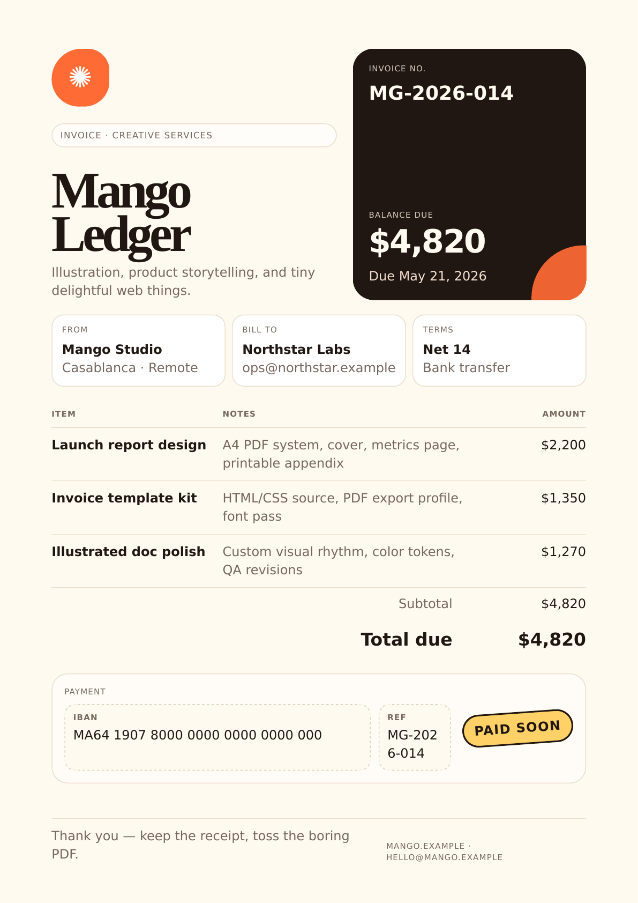

# WeasyPrint PDF Creation Skill

A reusable skill + starter kit for creating polished PDFs from HTML/CSS templates using [WeasyPrint](https://weasyprint.org/).

Best for:

- invoices
- reports
- proposals
- one-page briefs
- receipts
- account statements
- printable docs
- source-controlled PDF templates

Not best for:

- editing arbitrary existing PDFs
- OCR/scanned documents
- JavaScript-heavy dashboard capture

## Install as a skill

With skills.sh:

```bash
npx skills add https://github.com/slapash/weasyprint-pdf-skill --skill weasyprint-pdf-creation
```

Or clone/read directly:

```bash
git clone https://github.com/slapash/weasyprint-pdf-skill.git
cd weasyprint-pdf-skill
```

## Quick start in 60 seconds

```bash
python3 -m venv .venv
. .venv/bin/activate
pip install -r requirements.txt
python scripts/build_examples.py
```

Open:

```text
examples/index.html
```

Or render one template manually:

```bash
python scripts/render_pdf.py \
  --template templates/invoice.html \
  --data data/sample-invoice.json \
  --out outputs/invoice.pdf \
  --html-out outputs/invoice.html
python scripts/qa_pdf.py outputs/invoice.pdf \
  --expect-pages 1 \
  --must-contain 'Total due' \
  --must-contain 'PAYMENT'
```

## Example gallery

The gallery is generated into `examples/` and includes PDF, HTML, and PNG thumbnail previews.



Available examples:

- `examples/invoice.pdf`
- `examples/report.pdf`
- `examples/proposal.pdf`
- `examples/one-page-brief.pdf`
- `examples/receipt.pdf`
- `examples/statement.pdf`

## Repo contents

```text
SKILL.md                         # Hermes/skills.sh skill instructions
requirements.txt                 # pinned Python deps
scripts/render_pdf.py            # Jinja2 + WeasyPrint renderer
scripts/qa_pdf.py                # lightweight PDF QA helper
scripts/build_examples.py        # renders gallery PDFs/HTML/thumbnails
templates/invoice.html           # playful print-safe invoice template
templates/report.html            # one-page report template
templates/proposal.html          # proposal template
templates/one-page-brief.html    # decision brief template
templates/receipt.html           # compact A5 receipt template
templates/statement.html         # ledger/account statement template
data/sample-*.json               # sample data per template
docs/pdf-qa.md                   # QA checklist
docs/template-rules.md           # print-safe template rules
fonts/README.md                  # font reproducibility guidance
outputs/.gitkeep                 # render target folder
examples/                        # generated gallery artifacts
```

## Why this exists

Most PDF workflows are either ugly markdown exports, fragile browser screenshots, or low-level PDF drawing code.

This workflow keeps the nice part of web design — HTML/CSS — but renders through a print-first engine:

```text
HTML template + print CSS + data → WeasyPrint → PDF → QA → gallery
```

## Template rules

Short version:

- design A4 first, except intentionally compact docs such as receipts
- keep semantic HTML and print CSS in source control
- keep data in JSON
- use fixed columns for money-heavy tables
- wrap long strings with `overflow-wrap:anywhere`
- reserve space for stamps, badges, blobs, and footers
- test with ugly/long sample values
- check PDF text extraction before calling it done

See [`docs/template-rules.md`](docs/template-rules.md) and [`docs/pdf-qa.md`](docs/pdf-qa.md).

## License

MIT
